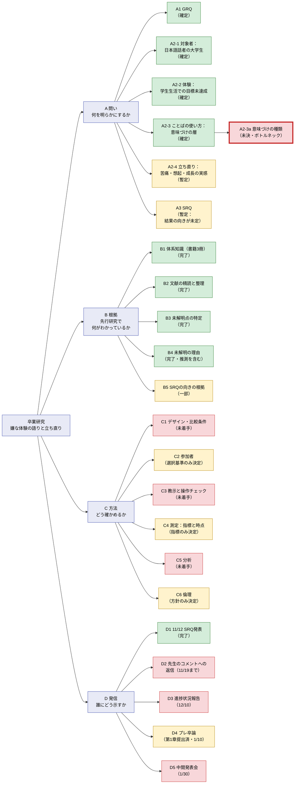
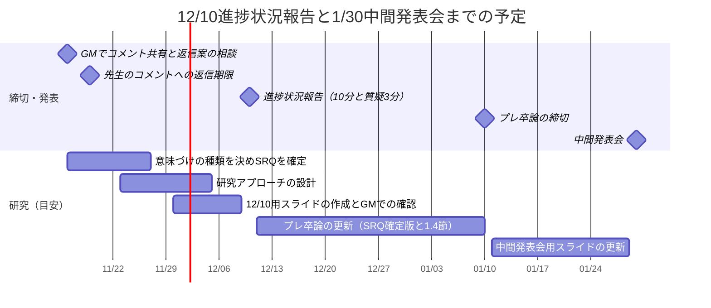

# 研究の現状と今後やること

最終更新：2026-11-15

11/9 GMで立てた目標「これまで調査してきたことを整理し、現時点で達成できていること、まだ達成できていないことを構造化して整理する」に対応する資料です。11/12 SRQ発表へのコメント対応と、12/10 進捗状況報告（SRQと研究アプローチの決定）に向けた作業の見取り図を兼ねます。

> **要点**：問いの枠組み（GRQ・対象者・体験・ことばの層・立ち直りの側面）と、先行研究の整理はおおむね固まった。残る最大のボトルネックは「どのような意味づけか」の中身（比べる意味づけの種類）である。これが決まらないと、SRQに結果の向きがつかず、12/10までに求められている研究アプローチの設計にも進めない。

## 1. 全体像

研究を「問い／根拠／方法／発信」の4つに分けた（A2-1〜A2-4は、GRQの要素を具体化したもの）。問いは「何を明らかにするか」、根拠は「先行研究で何がわかっているか」、方法は「どう確かめるか」、発信は「誰にどう示すか」を扱う。赤の太枠の「意味づけの種類」が決まると、SRQ（A3）の向きと、比較条件（C1）が決まる。

凡例：緑＝確定・完了／黄＝暫定・一部完了／赤＝未着手・未決／赤の太枠＝ボトルネック

## 2. ここまでの経緯

| 日付 | 出来事 |
| --- | --- |
| 10/12 | GRQを確定 |
| 10/19 | 体験の領域を「学生生活の中で、自分の目標を達成できなかった体験」に限定 |
| 10/26 | 先行研究が立ち直りを「いつ・何で」測っていたかを整理し、指標を絞る |
| 11/2 | SRQ案（距離をとって意味づける書き方 vs 距離をとるだけの書き方、3本）→ GMで「どのような意味づけが」に焦点を移す方針に転換 |
| 11/9 | SRQ案を「どのような意味づけをしようとする書き方が〜」の3本に更新 |
| 11/12 | プレ卒論（第1章）を提出、SRQ発表 |
| 11/13 | 12/10 進捗状況報告の指示（SRQの決定・研究アプローチの決定） |

## 3. 枝ごとの詳細

### A 問い：何を明らかにするか

| 項目 | 状態 | 現在の内容 | 残っていること |
| --- | --- | --- | --- |
| A1 GRQ | 確定 | 青年期（大学生）の日本語話者が嫌な体験を物語として語るとき、どのようなことばの使い方が立ち直りを助けるのか | なし |
| A2-1 対象者 | 確定 | 日本語話者の大学生 | なし |
| A2-2 体験 | 確定 | 学生生活の中で、自分の目標を達成できなかった体験。外傷体験に当たりうる出来事（災害・事故・暴力・いじめ・死別など）が背景にあるものは除く。結果が出ていて、嫌な気持ちが低〜中程度残る体験に限る | 他者への迷惑を含む体験は、事後の質問で苦痛の中心を確認する方針のみ |
| A2-3 ことばの使い方 | 確定 | 語・視点・筋・意味づけの4層のうち、意味づけの層に焦点を当てる。理由は、書く効果を説明する過程とされてきたこと、他の層の効果にも関与している可能性があること、教示で操作できること | なし |
| A2-3a 意味づけの種類 | **未決（ボトルネック）** | 候補：理解 vs 利点発見、原因の捉え方、自分とのつなげ方、受容 vs 救済、過去 vs 未来 | 2種類の比較に絞る（§4 論点1） |
| A2-4 立ち直り | 暫定 | 苦痛（IES-R-Jの侵入・回避）、想起（後日思い出して語るときの否定的な感情語）、成長の実感（PTGI-J）の3側面 | 成長の実感を「回復」の側面に含めてよいか（§4 論点2） |
| A3 SRQ | 暫定 | どのような意味づけをしようとする書き方が、書いてから時間をおいた後の ①侵入・回避を低くするか ②思い出して語るときの否定的な感情語を減少させるか ③成長の実感を高めるか | 「どのような」を埋めて結果の向きをつける。3本に共通する条件を冒頭にくくり出す（§5 コメント3） |

### B 根拠：先行研究で何がわかっているか

| 項目 | 状態 | 現在の内容 | 残っていること |
| --- | --- | --- | --- |
| B1 体系知識 | 完了 | 『可能世界の心理』『ナラティヴ研究』『ビジュアル・ナラティヴ』を通読。用語と英語表現をプレ卒論の表1.1に整理 | なし |
| B2 文献の精読と整理 | 完了 | 精読した10本の「明らかになっている点／いない点」をプレ卒論の付録Cに整理。参考文献は53編 | なし |
| B3 未解明点の特定 | 完了 | 意味づけの種類によって立ち直りのどの側面に効果が現れるかは、種類同士を比べた実験では確かめられていない。日本語話者の大学生の目標未達成の体験では、小規模・探索的な研究（木村・板倉 2025：19名・統制群なし、外山・藏本 2019：69名）にとどまる | 「本調査の範囲では」の留保つき。追加調査で覆る可能性は残る |
| B4 未解明の理由 | 完了（推測を含む） | 研究対象の偏り（死別が中心）、方法上の制約（相関研究が中心・小規模・記憶を評定するだけで苦痛が下がる）、研究領域ごとに測る側面が違う | なし |
| B5 SRQの向きの根拠 | 一部 | 候補ごとに、向きを予測する根拠を整理済み（SRQ発表準備ノート） | 決め手になる論文の本文の精読：Lichtenthal & Cruess (2010) の教示と結果、Guastella & Dadds (2008)（要旨のみ確認）、木村・板倉 (2025)（抄録のみ確認）、外山・藏本 (2019) |

### C 方法：どう確かめるか（12/10までに決定）

| 項目 | 状態 | 決まっていること | 決めること |
| --- | --- | --- | --- |
| C1 デザイン・比較条件 | 未着手 | なし | 比べる条件（意味づけ2種類に加えて対照条件を置くか）、参加者間か参加者内か。A2-3aが決まらないと決められない |
| C2 参加者 | 暫定 | 選択基準（目標未達成の体験があり、苦痛が低〜中程度、外傷体験を除く） | 人数（検出力から逆算）、募集方法（学内・クラウドソーシングなど）、除外基準（抑うつ傾向の強い人など） |
| C3 教示と操作チェック | 未着手 | 意味づけの「試み」を教示で促す（試みと、得られた意味とは区別する） | 教示文、書く時間と回数、教示どおりに書けたかの確かめ方 |
| C4 測定 | 暫定 | 指標：IES-R-J（侵入・回避）、PTGI-J、想起時の否定的な感情語。時点の案：事前・直後・追跡（1〜3週間後） | 追跡の時点（IES-R-Jは過去1週間を尋ねるため最短1週間）、想起の語りの取り方（口頭か筆記か） |
| C5 分析 | 未着手 | 感情語の計数に使える辞書としてJ-LIWC2015がある | 統計モデル、感情語の計数の手順、探索的な言語分析を含めるか（§4 論点5） |
| C6 倫理 | 暫定 | 体験の領域の限定、外傷体験の除外 | 研究倫理審査の手続き（要否を先生に確認）、反すうや自責を強めない教示、途中でやめられることと相談先の案内 |

### D 発信：誰にどう示すか

| 項目 | 状態 | 内容 | 次にやること | 期限 |
| --- | --- | --- | --- | --- |
| D1 SRQ発表 | 完了 | 5分＋質疑3分 | なし | 11/12 |
| D2 先生のコメントへの返信 | 未着手 | 3点（§5） | 11/16 GMでコメントを共有し、返信案を相談する → Slackで返信 | 11/19（次回ゼミ前） |
| D3 進捗状況報告 | 未着手 | 10分＋質疑3分。条件(7) GRQ→先行研究→SRQ→研究のアプローチを述べる。条件(8) 今学期の目標と進捗状況を述べる。11/12のスライドを元に、1/30中間発表会で使うスライドとして作る | SRQとアプローチを決め、スライド案をGMで確認 | 12/10 |
| D4 プレ卒論 | 暫定 | 第1章（Introduction）を提出済み。1.3節はSRQ案と今後の課題まで、1.4節（研究のアプローチ）は未記述 | SRQ確定版と1.4節の追記、仮題の見直し | 1/10（求められる範囲は要確認） |
| D5 中間発表会 | 未着手 | 12/10のスライドを更新して使う | 12/10のFBを反映 | 1/30 |

## 4. いま決めるべき論点

| # | 論点 | 選択肢 | 判断の基準 | 目安 |
| --- | --- | --- | --- | --- |
| 1 | 比べる意味づけの種類（最優先） | A 理解 vs 利点発見／B 原因を変えられるものとして捉える vs 原因を指定しない／C 自分とのつなげ方（成長 vs 性格）／D 受容 vs 救済／E 過去 vs 未来 | プレ卒論1.3.4節の基準：(a) 3つのSRQのいずれにも結果の向きを予測する根拠がある (b) 目標未達成の体験に適用できる (c) 参加者に過度の負担を与えない。加えて（提案）(d) 書かれた文章のことばで違いを確かめられる | 11/27頃 |
| 2 | 成長の実感の位置づけ | 3側面のまま（回復を補う側面と明記）／副次的な指標にする／外す | 「立ち直り＝回復」という定義との整合。利点発見型を比べる場合、書く内容と尺度の項目が重なり、結果が自明だと言われうる | 論点1と同時 |
| 3 | 語りの場面 | 一人で書く／他者に語る（口頭）／両方 | GRQの「語る」は話す・書くの両方を含むが、SRQは「書き方」を問う。統制のしやすさ、実施のしやすさ。11/12の質疑で出た論点 | 12/3頃 |
| 4 | 「時間をおいた後」の時点 | 1週間後のみ／1週間後と数週間後の2時点 | IES-R-Jの教示期間（過去1週間）、筆記直後の一時的な苦痛の増加、効果の持続を示せるか | 12/3頃 |
| 5 | 探索的な言語分析 | 含める（操作チェックを兼ねる）／含めない | GRQの「ことばの使い方」とのつながり、作業量 | 12/3頃 |

**論点1と論点5の関係（提案）**：GRQは「ことばの使い方」を問うが、SRQが操作するのは「意味づけをしようとする書き方」（教示）である。このままでは、言語の研究というより、書く介入の研究に見えるおそれがある。書かれた文章で、教示に沿った表現（例：理解型なら因果・洞察の語、利点発見型なら「学んだ」「おかげで」など）が実際に増えたかを数えれば、操作チェックとGRQへの接続を一度に果たせる。論点1の基準(d)は、この観点から加えた。

## 5. 11/12 SRQ発表へのコメントと対応方針

菊池先生からは、コメントに一週間以内（次回ゼミ前）に返信し、その前にGMで返信案を相談するよう指示がある（11/13 #b3_seminar）。

| # | コメント（要旨） | 対応方針（案） | 反映先 |
| --- | --- | --- | --- |
| 1 | 社会的な背景は、可能なら根拠を示す | 背景の各主張に出典をつける。プレ卒論1.1節にある根拠（Mol et al., 2005；早川ら, 2023；Frattaroli, 2006）をスライドにも明記する。「大学生はさまざまな嫌な体験をする」「言語化する機会は日常に多い（日記・SNS・相談）」には現状で出典がないため、大学生の悩みやSNS利用に関する全国調査・公的統計を探す（該当するデータがあるかは未確認） | 12/10スライド、プレ卒論1.1節 |
| 2 | #9の表など、構造的に整理されている | 表で構造化する形式を12/10でも続ける | 12/10スライド |
| 3 | SRQのスライドで、「青年期の日本語話者が嫌な体験を物語として語るとき」という共通項を冒頭で述べる | 3本のSRQに共通する条件を前置きとしてくくり出し、各SRQには違う部分だけを書く。例：「青年期（大学生）の日本語話者が、学生生活での目標未達成の体験を書くとき、」→ SRQ1 …侵入・回避を低くするか／SRQ2 …否定的な感情語を減少させるか／SRQ3 …成長の実感を高めるか | 12/10スライド、プレ卒論1.3.3節 |

発表スレッドには、次の3点も本人のメモとして残っている（質疑で出た論点と思われる）。返信の対象ではないが、方法の設計で答える必要がある。

| 論点 | 対応方針（案） | 関連 |
| --- | --- | --- |
| 「どれくらいの時間」は、どのくらいのスケールか | 心理的な指標で群の差が捉えられてきたのは1日〜2か月程度で、IES-R-Jは過去1週間を尋ねる（10/26 議事メモ）。これを根拠に追跡の時点を決める | §4 論点4 |
| 「曝露」とは何か | 用語の定義をスライドに入れる（体験を具体的に思い出し、感情に向き合って書くこと。Guastella & Dadds, 2008 の条件の一つ） | 用語表 |
| テキストでも、一人で語るのか他者に相談するのかで違うのでは | 語りの場面を設計上の論点にする。自己開示と受け手の反応が意味づけの過程で果たす役割を扱った研究がある（川須・福岡, 2025） | §4 論点3 |

## 6. スケジュール

12/10までの目安（SRQ確定・アプローチ設計）は、逆算した提案である。感性班GMは月曜3限。11/23は祝日のため、GMの有無を確認する。

## 7. 細かい未完了事項

- [ ] 木村・板倉 (2025) の本文で、過去／未来の条件差、教示文、IES-R-Jの測定時期を確認する（プレ卒論にTODOあり）
- [ ] Guastella & Dadds (2008) の本文を入手する（現状は要旨のみ）
- [ ] 伊藤ら (2009) で「広義のトラウマ」に当たる記述を本文で確認する
- [ ] SRQの表記をそろえる（議事メモ11/9版の「低くさせるか」「感情語は減少させるか」と、プレ卒論版の「低くするか」「感情語を減少させるか」）
- [ ] 体験の表記をそろえる（議事メモの「経験」とプレ卒論の「体験」）
- [ ] プレ卒論の題目（仮題）を、意味づけに焦点を移したことに合わせて見直す。学籍番号を記入する

## 8. 根拠資料

- [GM/2026秋議事メモ.md](2026秋議事メモ.md)
- [GM/先行研究調査課題.pdf](先行研究調査課題.pdf)
- プレ卒論 第1章（2026-11-11版）
- SRQ発表準備ノート（2026-11-08）
- Slack #presen：[11/12 SRQ発表への菊池先生のコメント](https://k-lab-waseda.slack.com/archives/C9TFU5Y2J/p1794473547868499?thread_ts=1794463717.363509&cid=C9TFU5Y2J)
- Slack #b3_seminar：[12/10 進捗状況報告の指示（11/13）](https://k-lab-waseda.slack.com/archives/CA4HTQ7EU/p1794528055344019)
- 菊池研究室 seminar/2026Fall.md「2026/11/12B3ゼミ」
