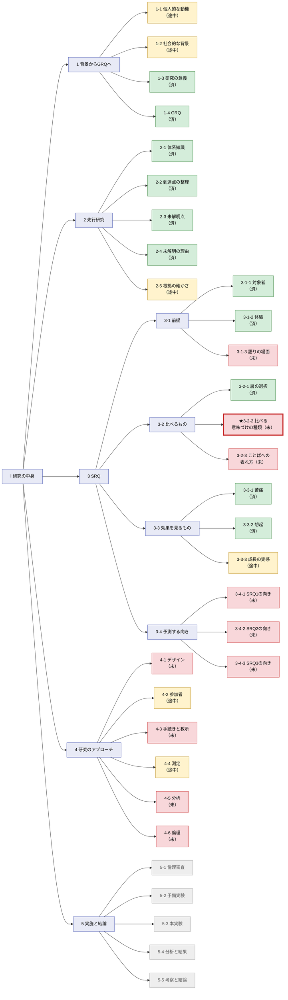
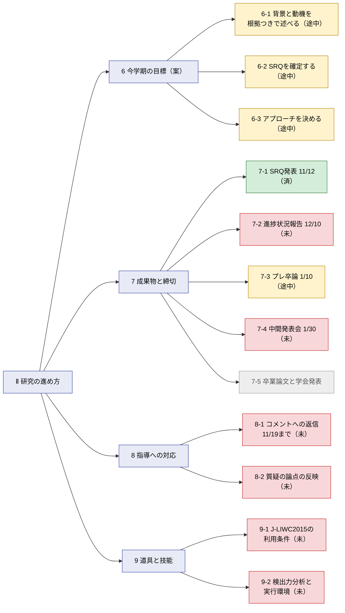
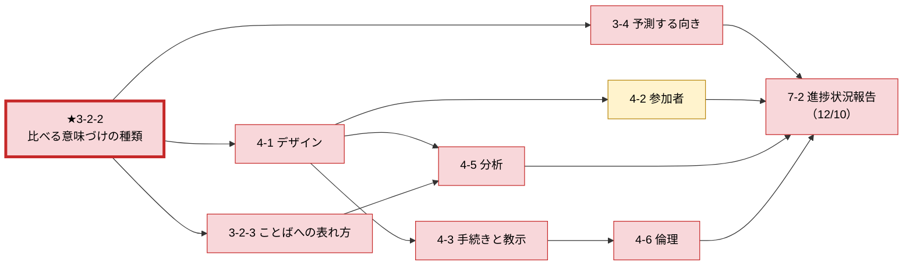
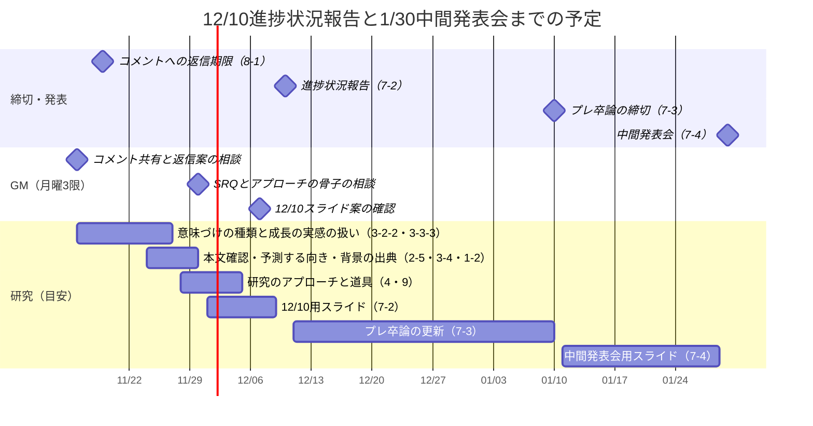

# 研究の現状と今後やること

最終更新：2026-11-15

11/9 GMで立てた目標「これまで調査してきたことを整理し、現時点で達成できていること、まだ達成できていないことを構造化して整理する」に対応する資料です。11/12 SRQ発表へのコメント対応と、12/10 進捗状況報告（SRQと研究アプローチの決定）に向けた作業の見取り図を兼ねます。

> **要点**：GRQ、先行研究の整理、SRQの前提（対象者と体験）、効果を見る側面は、おおむね固まった。残る未決のうち、SRQの向き（3-4）と研究のアプローチの大半（4-1〜4-3、4-5、4-6）は、★3-2-2「比べる意味づけの種類」が決まらないと決められない。12/10に向けてはここを最初に片づける。背景の出典、文献の本文確認、語りの場面、道具の確認などは、★と並行して進められる。

## 1. 全体像

### 読み方

- 研究を「Ⅰ 研究の中身」と「Ⅱ 研究の進め方」に分けた。Ⅰは論文の流れ（背景・GRQ → 先行研究 → SRQ → 研究のアプローチ → 結果）の順で、12/10の条件(7)の順序とそろえてある。Ⅱは、目標・成果物・指導への対応・道具の4つに分けた。
- 状態は末端の項目にだけつける。[済]＝決まった・終わった／[途中]＝案がある・一部終わった／[未]＝手をつけていない・決まっていない／★＝ほかの未決の起点。
- 同じ内容は1か所にだけ書き、ほかの場所からは番号で参照する（例：外傷体験の除外は3-1-2にだけ書く）。
- 未完了の項目の「次の一手」「完了の条件」「目安の期限」は §3 にまとめた。

### テキスト版

```text
卒業研究「嫌な体験の語りと立ち直り」（2026-11-15時点）
│
├─ Ⅰ 研究の中身（論文の流れの順）
│   │
│   ├─ 1 背景からGRQへ：なぜ問うか
│   │   ├─ [途中] 1-1 個人的な動機：曖昧な感情を言葉にして自分がわかった経験。「どんな社会にしたいか」の一文が資料に見当たらない
│   │   ├─ [途中] 1-2 社会的な背景：命に関わらない出来事でも外傷後ストレス反応は生じうる、など。一部の主張に出典がない
│   │   ├─ [済] 1-3 研究の意義：学生が自分で使える書き方の指針／語りを支える仕組みの設計／ことばの計量分析
│   │   └─ [済] 1-4 GRQ：青年期（大学生）の日本語話者が嫌な体験を物語として語るとき、どのようなことばの使い方が立ち直りを助けるのか
│   │
│   ├─ 2 先行研究：何がわかっていて、何がわかっていないか
│   │   ├─ [済] 2-1 体系知識：書籍3冊を通読し、用語と英語表現を整理
│   │   ├─ [済] 2-2 到達点の整理：精読10本の「明らか／未明」を整理（参考文献53編）
│   │   ├─ [済] 2-3 未解明点：意味づけの種類同士を比べた実験がない（本調査の範囲で）
│   │   ├─ [済] 2-4 未解明の理由：対象の偏り・方法の制約・測る側面の違い（推測を含む）
│   │   └─ [途中] 2-5 根拠の確かさ：要旨・抄録だけで引用している文献の本文を確認する
│   │
│   ├─ 3 SRQ：何を問うか
│   │   │   現在の文面：どのような意味づけをしようとする書き方が、書いてから時間をおいた後の
│   │   │   ①侵入・回避を低くするか ②思い出して語るときの否定的な感情語を減少させるか ③成長の実感を高めるか
│   │   ├─ 3-1 前提：誰が、どんな体験を、どう語るとき
│   │   │   ├─ [済] 3-1-1 対象者：日本語話者の大学生
│   │   │   ├─ [済] 3-1-2 体験：学生生活で自分の目標を達成できなかった体験（嫌な気持ちが低〜中程度残るもの。外傷体験は除く）
│   │   │   └─ [未] 3-1-3 語りの場面：一人で書くか、他者に語るか
│   │   ├─ 3-2 比べるもの：どのような意味づけか
│   │   │   ├─ [済] 3-2-1 層の選択：語・視点・筋・意味づけの4層のうち、意味づけ
│   │   │   ├─ [未]★ 3-2-2 比べる意味づけの種類：候補5つから2種類に絞る
│   │   │   └─ [未] 3-2-3 ことばへの表れ方：比べる意味づけが、文章のどんな表現に表れるか
│   │   ├─ 3-3 効果を見るもの：時間をおいた後の、立ち直りのどの側面か
│   │   │   ├─ [済] 3-3-1 苦痛：侵入・回避
│   │   │   ├─ [済] 3-3-2 想起：思い出して語るときの否定的な感情語
│   │   │   └─ [途中] 3-3-3 成長の実感：「回復」の側面に含めてよいかが未検討
│   │   └─ 3-4 予測する向き（仮説）：3-2-2が決まると立てられる
│   │       ├─ [未] 3-4-1 SRQ1（苦痛）の向き
│   │       ├─ [未] 3-4-2 SRQ2（想起）の向き
│   │       └─ [未] 3-4-3 SRQ3（成長の実感）の向き
│   │
│   ├─ 4 研究のアプローチ：どう確かめるか（12/10までに決める）
│   │   ├─ [未] 4-1 デザイン：比べる条件（2種類＋対照を置くか）、参加者間か参加者内か
│   │   ├─ [途中] 4-2 参加者：選択基準は3-1の前提どおり。人数・募集方法・除外基準が未定
│   │   ├─ [未] 4-3 手続きと教示：実験の流れ、教示文、教示どおりに書けたかの確認
│   │   ├─ [途中] 4-4 測定：指標は決定（IES-R-Jの侵入・回避、PTGI-J、否定的な感情語の数）。時点と、想起の語りの取り方が未定
│   │   ├─ [未] 4-5 分析：統計モデル、感情語と3-2-3の表現の数え方
│   │   └─ [未] 4-6 倫理：審査の要否、反すうや自責を強めない教示、中止の自由と相談先
│   │
│   └─ 5 実施と結論：何がわかったか（来年度）
│       ├─ [未] 5-1 倫理審査（必要な場合）
│       ├─ [未] 5-2 予備実験
│       ├─ [未] 5-3 本実験とデータ収集
│       ├─ [未] 5-4 分析と結果
│       └─ [未] 5-5 考察と結論
│
└─ Ⅱ 研究の進め方
    │
    ├─ 6 今学期の目標（案：自分の言葉で決める）
    │   ├─ [途中] 6-1 背景と動機を、根拠をつけて述べられる（1がすべて済になれば達成）
    │   ├─ [途中] 6-2 SRQを、結果の向きをもつ問いとして確定する（3がすべて済になれば達成）
    │   └─ [途中] 6-3 研究のアプローチを決める（4がすべて済になれば達成）
    │
    ├─ 7 成果物と締切
    │   ├─ [済] 7-1 SRQ発表（11/12）
    │   ├─ [未] 7-2 進捗状況報告（12/10）：1〜4を述べ（条件7）、6とその進捗を述べる（条件8）
    │   ├─ [途中] 7-3 プレ卒論（1/10）：第1章は提出済み。3の確定版と4が未記述
    │   ├─ [未] 7-4 中間発表会（1/30）：12/10のスライドを更新する
    │   └─ [未] 7-5 卒業論文と学会発表（来年度以降）
    │
    ├─ 8 指導への対応
    │   ├─ [未] 8-1 11/12発表への先生のコメント3点に返信する（11/16 GMで相談し、11/19までに）
    │   └─ [未] 8-2 質疑で出た論点3つを反映する（→ 3-1-3、4-4、7-2）
    │
    └─ 9 道具と技能
        ├─ [未] 9-1 感情語の計数：J-LIWC2015の利用条件（必要なソフト、分かち書き）を確かめる
        └─ [未] 9-2 統計：参加者数の見積もり（検出力分析）と、分析の実行環境を用意する
```

### 図版

凡例：緑＝済／黄＝途中／赤＝未／赤の太枠＝★／灰色＝来年度以降の工程

#### Ⅰ 研究の中身



#### Ⅱ 研究の進め方



## 2. 依存関係：★から12/10まで

矢印の先は、矢印の元が決まらないと決められない。

**★から始まる流れ**

- 3-2-2 比べる意味づけの種類 → 3-4 予測する向き → 7-2 進捗状況報告
- 3-2-2 → 4-1 デザイン → 4-2 参加者、4-3 手続きと教示、4-5 分析 → 7-2
- 3-2-2 → 3-2-3 ことばへの表れ方 → 4-5 分析

**合流する作業**

- 2-5 根拠の確かさ → 3-4
- 3-1-3 語りの場面 → 4-3、4-4
- 3-3-3 成長の実感の扱い → 4-4 測定 → 4-5
- 4-3 → 4-6 倫理
- 9-1 → 4-5、9-2 → 4-2
- 1-2 背景の出典、8-1 コメントへの返信 → 7-2

図版（★から12/10までの主な流れ。合流する作業は上の箇条書きを参照）：



## 3. 未完了の項目：次の一手と完了の条件

目安の期限は、12/10から逆算した提案である。来年度以降の工程（5、7-5）は、12/10以降に計画する。

| 項目 | 次の一手 | 完了の条件 | 目安 |
| --- | --- | --- | --- |
| 8-1 コメントへの返信 | 3点への返信案を書き、11/16 GMで相談する | Slackで3点すべてに返信している | 11/19 |
| ★3-2-2 比べる意味づけの種類 | 候補5つを基準(a)〜(d)（§4）で比べた表を作り、GMで相談する | 比べる2種類と、それぞれの教示の骨子が決まっている | 11/27 |
| 3-3-3 成長の実感 | 3側面のまま／副次的な指標にする／外す、から選ぶ | 扱いと、その理由を1文で書ける | 11/27 |
| 2-5 根拠の確かさ | 木村・板倉 (2025) と Guastella & Dadds (2008) の本文を入手し、伊藤ら (2009) で「広義のトラウマ」に当たる記述を確かめる | 要旨・抄録だけを根拠にした引用がない | 11/30 |
| 3-4 予測する向き | Lichtenthal & Cruess (2010) の教示と結果などを精読し、SRQ1〜3それぞれの向きを書く | 3本のSRQすべてに、向きとその根拠がある | 11/30 |
| 1-2 社会的な背景 | 「大学生はさまざまな嫌な体験をする」「言語化する機会は日常に多い」の出典を探す | 背景の主張すべてに出典がある | 11/30 |
| 3-1-3 語りの場面 | 一人で書くか、他者に語るかを決める | SRQの前提（3-1）に書き込める | 12/3 |
| 3-2-3 ことばへの表れ方 | 比べる2種類が、どんな表現に表れるかを予想する | 数える表現の候補が挙がっている | 12/3 |
| 4-1 デザイン | 比べる条件と群の組み方を決める | 条件、対照の有無、参加者間か参加者内かが決まっている | 12/3 |
| 4-4 測定 | 追跡の時点と、想起の語りの取り方を決める | すべての指標について、測る時点と方法が決まっている | 12/3 |
| 9-1 J-LIWC2015の利用条件 | 配布元で、利用条件と必要な準備を確かめる | 使えるかどうかと、使うための準備がわかっている | 12/3 |
| 9-2 検出力分析と実行環境 | 検出力分析のやり方と、使うソフトを決める | 4-2の人数を計算できる | 12/3 |
| 4-2 参加者 | 人数の根拠と募集方法、除外基準を決める | 人数・募集方法・除外基準が決まっている | 12/5 |
| 4-3 手続きと教示 | 実験の流れ図と、条件ごとの教示文の案を作る | 流れ図と教示文の案がある | 12/5 |
| 4-5 分析 | SRQごとの分析方針を書く | SRQ1〜3のそれぞれに、分析の方法が対応している | 12/5 |
| 4-6 倫理 | 審査の要否を先生に確認し、配慮事項を挙げる | 審査の要否と、配慮事項の一覧がある | 12/5 |
| 1-1 個人的な動機 | 「どんな社会にしたいか」を一文で書く | 12/10のスライドに載せられる | 12/7 |
| 6 今学期の目標 | 6-1〜6-3の案を、自分の言葉で決め直す | 12/10のスライドに、目標と達成状況を書ける | 12/7 |
| 7-2 進捗状況報告 | スライド案を作り、12/7 GMで確認する | 条件(7)(8)を満たし、10分に収まる | 12/10 |
| 8-2 質疑の論点の反映 | 3点を、3-1-3・4-4・7-2の用語の説明に反映する | 3点すべてが、設計かスライドに反映されている | 12/10 |
| 7-3 プレ卒論 | SRQ確定版と研究のアプローチを追記し、下の表記と体裁を直す | 提出している | 1/10 |
| 7-4 中間発表会 | 12/10のFBを反映し、研究室の発表構成の指定（今年度分は要確認）に沿ってスライドを更新する | 発表している | 1/30 |

**表記と体裁（7-2・7-3で直す）**

- [ ] SRQの表記をそろえる（議事メモ11/9版の「低くさせるか」「感情語は減少させるか」と、プレ卒論版の「低くするか」「感情語を減少させるか」）
- [ ] 「経験」（議事メモ）と「体験」（プレ卒論）をそろえる
- [ ] プレ卒論の題目（仮題）を、意味づけに焦点を移したことに合わせて見直し、学籍番号を記入する

## 4. 決めるべき論点：選択肢と判断の基準

| 項目 | 論点 | 選択肢 | 判断の基準 |
| --- | --- | --- | --- |
| ★3-2-2 | 比べる意味づけの種類 | A 理解 vs 利点発見／B 原因を変えられるものとして捉える vs 原因を指定しない／C 自分とのつなげ方（成長 vs 性格）／D 受容 vs 救済／E 過去 vs 未来 | プレ卒論1.3.4節の基準：(a) 3つのSRQのいずれにも、結果の向きを予測する根拠がある (b) 目標未達成の体験に適用できる (c) 参加者に過度の負担を与えない。加えて（提案）(d) 書かれた文章のことばで違いを確かめられる |
| 3-3-3 | 成長の実感の位置づけ | 3側面のまま（回復を補う側面と明記）／副次的な指標にする／外す | 「立ち直り＝回復」という定義との整合。利点発見型を比べる場合、書く内容と尺度の項目が重なり、結果が自明だと言われうる |
| 3-1-3 | 語りの場面 | 一人で書く／他者に語る（口頭）／両方 | GRQの「語る」は話す・書くの両方を含むが、SRQは「書き方」を問う。統制のしやすさ、実施のしやすさ。11/12の質疑で出た論点 |
| 4-4 | 「時間をおいた後」の時点 | 1週間後のみ／1週間後と数週間後の2時点 | IES-R-Jの教示期間（過去1週間）、筆記直後の一時的な苦痛の増加、効果の持続を示せるか |
| 3-2-3・4-5 | 探索的な言語分析 | 含める（操作チェックを兼ねる）／含めない | GRQの「ことばの使い方」とのつながり、作業量 |

**3-2-3と基準(d)を加えた理由（提案）**：GRQは「ことばの使い方」を問うが、SRQが操作するのは「意味づけをしようとする書き方」（教示）である。このままでは、言語の研究というより、書く介入の研究に見えるおそれがある。書かれた文章で、教示に沿った表現（例：理解型なら因果・洞察の語、利点発見型なら「学んだ」「おかげで」など）が実際に増えたかを数えれば、操作チェックとGRQへの接続を一度に果たせる。

## 5. 11/12 SRQ発表へのコメントと対応方針

菊池先生からは、コメントに一週間以内（次回ゼミ前）に返信し、その前にGMで返信案を相談するよう指示がある（11/13 #b3_seminar）。

| # | コメント（要旨） | 対応方針（案） | 項目 |
| --- | --- | --- | --- |
| 1 | 社会的な背景は、可能なら根拠を示す | 背景の各主張に出典をつける。プレ卒論1.1節にある根拠（Mol et al., 2005；早川ら, 2023；Frattaroli, 2006）をスライドにも明記する。「大学生はさまざまな嫌な体験をする」「言語化する機会は日常に多い（日記・SNS・相談）」には現状で出典がないため、大学生の悩みやSNS利用に関する全国調査・公的統計を探す（該当するデータがあるかは未確認） | 1-2 |
| 2 | #9の表など、構造的に整理されている | 表で構造化する形式を12/10でも続ける | 7-2 |
| 3 | SRQのスライドで、「青年期の日本語話者が嫌な体験を物語として語るとき」という共通項を冒頭で述べる | 3本に共通する前提（3-1）を前置きとしてくくり出し、各SRQには違う部分だけを書く。例：「青年期（大学生）の日本語話者が、学生生活での目標未達成の体験を書くとき、」→ SRQ1 …侵入・回避を低くするか／SRQ2 …否定的な感情語を減少させるか／SRQ3 …成長の実感を高めるか | 3-1、7-2 |

発表スレッドには、次の3点も本人のメモとして残っている（質疑で出た論点と思われる）。返信の対象ではないが、設計かスライドで答える必要がある（8-2）。

| 論点 | 対応方針（案） | 項目 |
| --- | --- | --- |
| 「どれくらいの時間」は、どのくらいのスケールか | 心理的な指標で群の差が捉えられてきたのは1日〜2か月程度で、IES-R-Jは過去1週間を尋ねる（10/26 議事メモ）。これを根拠に追跡の時点を決める | 4-4 |
| 「曝露」とは何か | 用語の定義をスライドに入れる（体験を具体的に思い出し、感情に向き合って書くこと。Guastella & Dadds, 2008 の条件の一つ） | 7-2 |
| テキストでも、一人で語るのか他者に相談するのかで違うのでは | 語りの場面を、SRQの前提として決める。自己開示と受け手の反応が意味づけの過程で果たす役割を扱った研究がある（川須・福岡, 2025） | 3-1-3 |

## 6. スケジュール

「作業（目安）」の期間とGMでの相談内容は、締切から逆算した提案である。感性班GMは月曜3限。11/23は祝日のため、GMの有無を確認する。

| 日付 | 種類 | 内容 | 項目 |
| --- | --- | --- | --- |
| 11/16（月） | GM | 先生のコメントを共有して返信案を相談し、意味づけの種類の候補も相談する | 8-1、3-2-2 |
| 11/16〜11/27 | 作業（目安） | 意味づけの種類と、成長の実感の扱いを決める | 3-2-2、3-3-3 |
| 11/19（木） | 締切 | 先生のコメントへの返信（次回ゼミ前） | 8-1 |
| 11/24〜11/30 | 作業（目安） | 本文確認と精読をして予測する向きを書き、背景の出典を探す | 2-5、3-4、1-2 |
| 11/28〜12/5 | 作業（目安） | 研究のアプローチを設計し、道具を確かめる | 3-1-3、3-2-3、4、9 |
| 11/30（月） | GM | 向きのついたSRQと、アプローチの骨子を相談する | 3、4 |
| 12/1〜12/9 | 作業（目安） | 12/10用のスライドを作る | 1-1、6、7-2 |
| 12/7（月） | GM | スライド案を確認する | 7-2 |
| 12/10（木） | 発表 | 進捗状況報告（10分＋質疑3分） | 7-2 |
| 12/11〜1/10 | 作業（目安） | プレ卒論を更新する（SRQ確定版と研究のアプローチ、表記と体裁） | 7-3 |
| 1/10（日） | 締切 | プレ卒論 | 7-3 |
| 1/11〜1/29 | 作業（目安） | 中間発表会用にスライドを更新する | 7-4 |
| 1/30（土） | 発表 | 中間発表会 | 7-4 |

図版（上の表と同じ内容）：



## 7. ここまでの経緯

| 日付 | 出来事 |
| --- | --- |
| 10/12 | GRQを確定 |
| 10/19 | 体験の領域を「学生生活の中で、自分の目標を達成できなかった体験」に限定 |
| 10/26 | 先行研究が立ち直りを「いつ・何で」測っていたかを整理し、指標を絞る |
| 11/2 | SRQ案（距離をとって意味づける書き方 vs 距離をとるだけの書き方、3本）→ GMで「どのような意味づけが」に焦点を移す方針に転換 |
| 11/9 | SRQ案を「どのような意味づけをしようとする書き方が〜」の3本に更新 |
| 11/12 | プレ卒論（第1章）を提出、SRQ発表 |
| 11/13 | 12/10 進捗状況報告の指示（SRQの決定・研究アプローチの決定） |

## 8. 根拠資料

- [GM/2026秋議事メモ.md](2026秋議事メモ.md)
- [GM/先行研究調査課題.pdf](先行研究調査課題.pdf)
- プレ卒論 第1章（2026-11-11版）
- SRQ発表準備ノート（2026-11-08）
- Slack #presen：[11/12 SRQ発表への菊池先生のコメント](https://k-lab-waseda.slack.com/archives/C9TFU5Y2J/p1794473547868499?thread_ts=1794463717.363509&cid=C9TFU5Y2J)
- Slack #b3_seminar：[12/10 進捗状況報告の指示（11/13）](https://k-lab-waseda.slack.com/archives/CA4HTQ7EU/p1794528055344019)
- 菊池研究室 seminar/2026Fall.md：「2026/11/12B3ゼミ」、および昨年度の「2026/1/15B3ゼミ」の中間発表指導（発表の構成の指定、「卒研は学会発表がゴール」）
