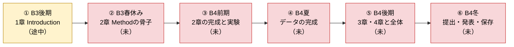
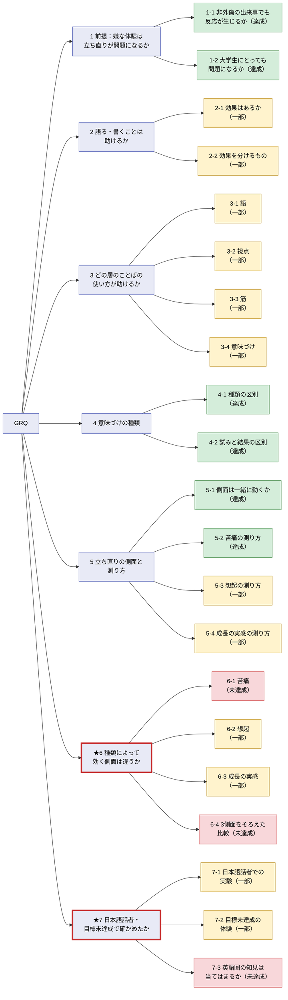

# 研究進捗の構造化

最終更新：2026-11-16

> **要点**：先行研究で達成されているのは(a) 語る・書くことには効果があるが、小さく条件で変わること、(b) 書き方で効果が変わり、意味づけが鍵とされること、(c) 意味づけには種類があり、立ち直りの側面（苦痛・想起・成長の実感）は別々に動くことである（独立というわけではない）。達成されていないのは、(d) 意味づけの種類によって立ち直りのどの側面に効果が現れるかを、種類同士を比べた実験で確かめること、(e) それを日本語話者の大学生の目標未達成の体験で確かめること。

## 1. 研究自体に関する検討
- [済]＝その節が卒論に書ける段階／[途中]＝書いてあるが穴がある、または案の段階／[未]＝手をつけていない。〈〉は研究室の締切（今年度の実績）。（提案）は研究室の指定ではなく、この資料からの提案。
 
### テキスト版
 
```text
卒業研究「嫌な体験の語りと立ち直り」 ― ゴール：IMRaDに沿った卒論、卒研発表会、学会発表
│
├─ ① B3後期（〜1月）　ゴール：1章（Introduction）が、研究のアプローチまで書けている
│   ├─ [途中] 1.1 動機と背景：プレ卒論で提出済み。出典のない主張が2つと、「どんな社会にしたいか」の一文が残る
│   ├─ [済] 1.2 関連研究：GRQに対して、先行研究で何がどこまで明らかかを整理した
│   ├─ [途中] 1.3 SRQ：3本の枠組みはあるが、比べる意味づけの種類が空欄で、向きがない
│   ├─ [未] 1.4 研究のアプローチ：SRQを実証する方法の概要（比べる条件、参加者、手続き、測定、分析の骨子）
│   ├─ 締切
│   │   ├─ 〈12/10〉進捗状況報告：SRQの決定と研究アプローチの決定（10分＋質疑3分）
│   │   ├─ 〈1/10〉プレ卒論：IMRaDの1章（研究のアプローチを含む）と文献リスト
│   │   ├─ 〈1/14〉プレ卒論指導・中間発表指導、〈1/21〉中間発表会の練習
│   │   └─ 〈1/30〉中間発表会（昨年度は7分＋質疑3分）
│   │       └─ 構成（昨年度の指定）：GRQ、動機と「どんな社会にしたいか」、SRQ、研究のアプローチ、今学期の目標
│   └─ 詳細は第2層（§4）
│
├─ ② B3春休み（2〜3月）　ゴール：2章（Method）の骨子ができ、実験の前提条件がそろっている
│   ├─ [未] 実験計画書の下書き：参加者、材料（教示文・尺度）、手続き、分析の計画（提案）
│   ├─ [未] 倫理審査が必要かどうかを、先生に確認する（提案。§3-2）
│   ├─ [未] 予備実験の準備：研究室メンバーなどに教示文を試してもらう（提案）
│   ├─ [未] 先輩の卒論（Box：k-lab/docs/2025thesis）から実験系のものを選び、2章の書き方を確かめる（提案）
│   ├─ [未] 学会を聴講する：研究室のメモに、B3のうちに学会を見ておく大切さが書かれている（提案）
│   └─ 締切
│       └─ 〈4/1以降〉B4初回ゼミの課題：プレ卒論を#b4_seminarに提出
│           └─ 条件：1章が書けている／文献リストがある／SRQが定まっている／研究のアプローチが書けている
│
├─ ③ B4前期（4〜7月）　ゴール：2章（Method）が「明日、他人が実験できる」水準で完成し、実験を始めている
│   ├─ [未] 研究計画発表と、SRQの詳細化（対象・範囲・比較対象・評価尺度が書かれているか）
│   ├─ [未] 卒業研究題目・計画概要届：題目からSRQが読み取れる。概要300字程度（ゴール、アプローチ、検証）
│   ├─ [未] 実験計画書（＝卒論2章）：教示文、アンケート、実験スケジュール、なぜその選択をしたかの理由まで書く
│   ├─ [未] 倫理審査（必要な場合）と、同意書・説明文書
│   ├─ [未] 参加者の募集と本実験（研究室の標準は6月末〜7月に実験。授業での募集は春学期のほうが集まりやすい）
│   └─ 締切
│       ├─ 〈4月中旬〉初回ゼミ、〈4月下旬〉研究計画発表
│       ├─ 〈5/15〉卒業研究題目・計画概要届
│       ├─ 〈6/28〉実験計画書（完成度を%で報告。不足が多ければ予備実験をする）
│       └─ 〈7/20〉中間発表会（それまでに実験計画書の完成版）
│
├─ ④ B4夏（8〜9月）　ゴール：データがそろい、3章（Results）に載せる図表の予定が立っている
│   ├─ [未] データ収集の完了と、データの整備
│   ├─ [未] 夏合宿のポスター：結果と考察の欄は空欄でよいが、載せる予定の図表を書く
│   └─ 締切
│       ├─ 〈9月〉夏合宿でポスター発表
│       └─ 〈9/30〉修正した計画書の提出：卒論の2章（Method）まで完成している段階が望ましい
│
├─ ⑤ B4後期（10〜12月）　ゴール：3章（Results）と4章（Discussion）を書き、卒論の全体ができる
│   ├─ [未] 分析（研究室の標準は9月末〜10月）
│   ├─ [未] 卒論の執筆、修正、追加分析
│   └─ 締切
│       ├─ 〈10月下旬〉合同発表会（ポスターと1分発表。被験者募集の機会にもなる）
│       ├─ 〈11/1〉卒研要旨（結果の欄を確保し、書く予定の内容を括弧書きで入れる）
│       ├─ 〈11/16〉題目届、〈11/29〉卒論仮提出
│       └─ 〈12/20〉卒論〆切（研究室の年間スケジュール表の表記のまま）
│
└─ ⑥ B4冬（1〜2月）　ゴール：卒論を提出して発表し、データを後輩が使える形で残す
    ├─ [未] 卒論の最終提出と大学への提出（要旨は提出後に直せない。本体は3月まで修正できる）
    ├─ [未] 卒研発表会（B4は15分。B3の中間発表のIntroductionを再利用できる）
    ├─ [未] アーカイブ提出：分析をやり直せるように、データ・教示文・分析コードをすべて残す
    ├─ [未] 学会発表：研究室の方針は「卒研は学会発表がゴール」
    └─ 締切
        ├─ 〈1/8〉最終提出、〈1/15〉卒論提出
        ├─ 〈1/30〉卒研発表会
        └─ 〈2月末〉提出物の期限（アーカイブなど）
```
 
### 図版
 
凡例：黄＝途中／赤＝未着手
 

 
## 2. 卒論の章（IMRaD）ごとの状態
| 章 | 中身（研究室の指定） | いまの状態 | 完成させる時期 |
| --- | --- | --- | --- |
| 1章 Introduction | 社会的な背景と解決すべき問題（＝目的）、先行研究で何がどこまで明らかか、まだ明らかでない課題（＝目標）。流れはGRQ → 先行研究 → SRQ → 研究のアプローチ。個人的な動機は1章の中に収める | 1.2は済。1.1と1.3は途中。1.4（研究のアプローチ）は未 | B3後期（1/10のプレ卒論、4/1以降のB4初回ゼミの課題）。B4でも文献を足して更新する |
| 2章 Method | 実験計画書がそのまま2章になる。参加者、材料（教示文・尺度）、手続き、分析の計画、倫理的な配慮。「明日、他人が実験できる」水準 | 未（測る指標だけ決まっている） | B4前期（6/28の計画書、7/20前の完成版）。遅くとも9/30 |
| 3章 Results | SRQごとの分析の結果。有意差の有無にかかわらず、調べたことを載せる | 未 | B4後期（分析は9月末〜10月） |
| 4章 Discussion | SRQへの答え、先行研究との比較、限界と今後の課題 | 未 | B4後期〜冬（11/29仮提出、12/20〆切） |
| 要旨・付録 | 要旨は外部に出す文書で、提出後は直せない。付録に関連文献リスト | 関連文献リストはプレ卒論の付録にある | 要旨は11/1に骨格、1月に最終版 |
 
## 3. 研究のアプローチを考えるときに押さえること
### 3-1. 研究室が求める「研究のアプローチ」の水準
- 1章のSRQの後に「研究のアプローチ」の節を置く。今年度のB4も、計画書で節がないと再提出になっていた（7/16、8/1 #b4_seminar）
- 中身は「SRQを実証するための研究方法の概要」（3/21 #b3_seminar）。B4の計画概要届では、ゴール（SRQ）、ゴールに到達するためのアプローチ（データ収集・実験・分析など）、ゴールに到達できたと主張するための検証を、300字程度で書く（5/7 #b4_seminar）
- 大まかな方法（アプローチ）は1章に、詳しい方法は実験計画書（＝2章以降）に書き分ける（5/7 #b4_seminar）
- SRQの詳細化のチェック項目：対象は書かれているか／範囲は明確か／比較対象は何か／評価尺度は何か（2026/4/23 B4ゼミ）
- SRQは「AとBはどのような関係か」ではなく、向きのある問いにする（10/6 #b4_seminar）
 
### 検出力（参加者の人数）
- 2群の差を、両側α＝.05・検出力.80で検出するのに必要な人数（1群あたり）：効果量d＝0.8なら26名、0.5なら64名、0.3なら176名、0.2なら394名
- 書く効果は平均すると小さく（r＝.075：Frattaroli, 2006）、意味づけの種類同士の差はさらに小さい可能性がある。理解型と利点発見型を比べた実験では、1群20名未満で差が出なかった（Lichtenthal & Cruess, 2010）〈推測を含む〉
- 追跡では脱落が出る（Lichtenthal & Cruess では40%）。d＝0.5で脱落を30%見込むと、1群92名を集める必要がある
- 今年度のB4の実験は、多くが1つあたり10〜40名程度（最大80名）
- 打ち手の候補：事前の得点を共変量に入れる（事前と事後の相関が.5なら必要人数はおよそ4分の3、.7ならおよそ半分）／効果が大きいと見込める指標を主にする／オンラインにして、授業やクラウドソーシングで集める／効果量の推定を目的にした探索的な位置づけにする。どれを選ぶかはGMと先生に相談する

状態：[済]＝決まった・終わった／[途中]＝案がある・一部終わった／[未]＝手をつけていない・決まっていない／★＝ほかの未決の起点。状態は末端の項目にだけつける。
```text
B3後期（〜1月）の詳細：第1層の①を細かくしたもの（2026-11-16時点）
│
├─ Ⅰ 研究の中身（論文の流れの順）
│   │
│   ├─ 1 背景からGRQへ：なぜ問うか
│   │   ├─ [途中] 1-1 個人的な動機：曖昧な感情を言葉にして自分がわかった経験。「どんな社会にしたいか」の一文が資料に見当たらない
│   │   ├─ [途中] 1-2 社会的な背景：命に関わらない出来事でも外傷後ストレス反応は生じうる、など。一部の主張に出典がない
│   │   ├─ [済] 1-3 研究の意義：学生が自分で使える書き方の指針／語りを支える仕組みの設計／ことばの計量分析
│   │   └─ [済] 1-4 GRQ：青年期（大学生）の日本語話者が嫌な体験を物語として語るとき、どのようなことばの使い方が立ち直りを助けるのか
│   │
│   ├─ 2 先行研究：何がわかっていて、何がわかっていないか
│   │   ├─ [済] 2-1 体系知識：書籍3冊を通読し、用語と英語表現を整理
│   │   ├─ [済] 2-2 到達点の整理：精読10本の「明らか／未明」を整理（参考文献53編）
│   │   ├─ [済] 2-3 未解明点：意味づけの種類同士を比べた実験がない（本調査の範囲で）
│   │   ├─ [済] 2-4 未解明の理由：対象の偏り・方法の制約・測る側面の違い（推測を含む）
│   │   └─ [途中] 2-5 根拠の確かさ：要旨・抄録だけで引用している文献の本文を確認する
│   │
│   ├─ 3 SRQ：何を問うか
│   │   │   現在の文面：どのような意味づけをしようとする書き方が、書いてから時間をおいた後の
│   │   │   ①侵入・回避を低くするか ②思い出して語るときの否定的な感情語を減少させるか ③成長の実感を高めるか
│   │   ├─ 3-1 前提：誰が、どんな体験を、どう語るとき
│   │   │   ├─ [済] 3-1-1 対象者：日本語話者の大学生
│   │   │   ├─ [済] 3-1-2 体験：学生生活で自分の目標を達成できなかった体験（嫌な気持ちが低〜中程度残るもの。外傷体験は除く）
│   │   │   └─ [未] 3-1-3 語りの場面：一人で日記のように書くか、SNS上で相談するように書くか、口頭か（録音するなら倫理審査に寄る → §3-2）
│   │   ├─ 3-2 比べるもの：どのような意味づけか
│   │   │   ├─ [済] 3-2-1 層の選択：語・視点・筋・意味づけの4層のうち、意味づけ
│   │   │   ├─ [未]★ 3-2-2 比べる意味づけの種類：候補5つから2種類に絞る
│   │   │   └─ [未] 3-2-3 ことばへの表れ方：比べる意味づけが、文章のどんな表現に表れるか
│   │   ├─ 3-3 効果を見るもの：時間をおいた後の、立ち直りのどの側面か
│   │   │   ├─ [済] 3-3-1 苦痛：侵入・回避
│   │   │   ├─ [済] 3-3-2 想起：思い出して語るときの否定的な感情語
│   │   │   └─ [途中] 3-3-3 成長の実感：「回復」の側面に含めてよいかが未検討
│   │   └─ 3-4 予測する向き（仮説）：3-2-2が決まると立てられる
│   │       ├─ [未] 3-4-1 SRQ1（苦痛）の向き
│   │       ├─ [未] 3-4-2 SRQ2（想起）の向き
│   │       └─ [未] 3-4-3 SRQ3（成長の実感）の向き
│   │
│   ├─ 4 研究のアプローチ：どう確かめるか（12/10までに決める）
│   │   ├─ [未] 4-1 デザイン：比べる条件（2種類＋対照を置くか）、参加者間か参加者内か
│   │   ├─ [途中] 4-2 参加者：選択基準は3-1の前提どおり。人数・募集方法・除外基準が未定
│   │   ├─ [未] 4-3 手続きと教示：実験の流れ、教示文、教示どおりに書けたかの確認
│   │   ├─ [途中] 4-4 測定：指標は決定（IES-R-Jの侵入・回避、PTGI-J、否定的な感情語の数）。時点と、想起の語りの取り方が未定
│   │   ├─ [未] 4-5 分析：統計モデル、感情語と3-2-3の表現の数え方
│   │   └─ [未] 4-6 倫理：審査の要否、反すうや自責を強めない教示、中止の自由と相談先
│   │
│   └─ 5 実施と結論：何がわかったか（来年度）
│       └─ → 第1層の②〜⑥で管理する
│
└─ Ⅱ 研究の進め方
    │
    ├─ 6 今学期の目標（案：自分の言葉で決める）
    │   ├─ [途中] 6-1 背景と動機を、根拠をつけて述べられる（1がすべて済になれば達成）
    │   ├─ [途中] 6-2 SRQを、結果の向きをもつ問いとして確定する（3がすべて済になれば達成）
    │   └─ [途中] 6-3 研究のアプローチを決める（4がすべて済になれば達成）
    │
    ├─ 7 成果物と締切
    │   ├─ [済] 7-1 SRQ発表（11/12）
    │   ├─ [未] 7-2 進捗状況報告（12/10）：1〜4を述べ（条件7）、6とその進捗を述べる（条件8）
    │   ├─ [途中] 7-3 プレ卒論（1/10）：第1章は提出済み。3の確定版と4が未記述
    │   ├─ [未] 7-4 中間発表会（1/30）：12/10のスライドを更新する
    │   └─ 7-5 来年度以降の締切（B4初回ゼミの課題、計画概要届、実験計画書、卒論、卒研発表会） → 第1層で管理する
    │
    ├─ 8 指導への対応
    │   ├─ [未] 8-1 11/12発表への先生のコメント3点に返信する（11/16 GMで相談し、11/19までに）
    │   └─ [未] 8-2 質疑で出た論点3つを反映する（→ 3-1-3、4-4、7-2）
    │
    └─ 9 道具と技能
        ├─ [未] 9-1 感情語の計数：J-LIWC2015の利用条件（必要なソフト、分かち書き）を確かめる
        └─ [未] 9-2 統計：参加者数の見積もり（検出力分析）と、分析の実行環境を用意する（目安は §3-2）
```
 
**依存関係（★から12/10まで）**：矢印の先は、矢印の元が決まらないと決められない。
 
- 3-2-2 比べる意味づけの種類 → 3-4 予測する向き → 7-2 進捗状況報告
- 3-2-2 → 4-1 デザイン → 4-2 参加者、4-3 手続きと教示、4-5 分析 → 7-2
- 3-2-2 → 3-2-3 ことばへの表れ方 → 4-5 分析
- 合流する作業：2-5 根拠の確かさ → 3-4／3-1-3 語りの場面 → 4-3、4-4、4-6／3-3-3 成長の実感の扱い → 4-4 → 4-5／9-1 → 4-5、9-2 → 4-2／1-2 背景の出典、8-1 コメントへの返信 → 7-2

## 2. テーマに関する検討
- [達成]＝先行研究がおおむね答えている／[一部]＝答えはあるが、対象・方法・条件に限りがある／[未達成]＝答えが見当たらない（本調査の範囲で）。★＝SRQが扱う問い。
- 根拠の種類を〈〉で示す。〈メタ分析〉〈実験〉〈相関〉〈調査〉〈総説〉など。日本の参加者による研究には〈日本〉をつけた。

### テキスト版

```text
GRQ：青年期（大学生）の日本語話者が嫌な体験を物語として語るとき、どのようなことばの使い方が立ち直りを助けるのか
│
├─ 1 嫌な体験は、立ち直りが問題になる出来事か（前提）
│   ├─ [達成] 1-1 命に関わらない出来事でも、外傷後ストレス反応は生じるか
│   │   └─ 明らか
│   │       ├─ 離婚や失業の後にも、事故や虐待の後と同程度以上の反応が報告された〈調査〉（Mol ら, 2005）
│   │       └─ 日本でも「広義のトラウマ」として研究されてきた（伊藤ら, 2009）
│   └─ [達成] 1-2 大学生にとっても問題になるか
│       └─ 明らか
│           └─ 大学生でも、外傷後ストレス反応とレジリエンスとの関連が報告されている〈日本・調査〉（早川ら, 2023）
│
├─ 2 語る・書くことは、立ち直りを助けるか
│   ├─ [一部] 2-1 効果はあるか
│   │   ├─ 明らか
│   │   │   ├─ 有意な効果はあるが小さく（r = .075）、大きさは条件で変わる〈メタ分析・146研究〉（Frattaroli, 2006）
│   │   │   └─ 臨床では、物語に基づく介入がPTSD症状を減らす〈メタ分析〉（Raeder ら, 2023）
│   │   └─ 未明
│   │       ├─ 非臨床の大学生が自分で語る場面にも当てはまるか（臨床の介入は、PTSDの症状をもつ人を対象に治療者が主導する）
│   │       └─ 日本の筆記開示の実験は小規模で、手続きを改訂した再検証が必要とされている〈日本・25名〉（伊藤ら, 2009）
│   └─ [一部] 2-2 効果を分けるのは何か
│       ├─ 明らか
│       │   ├─ 同じ種類の体験でも、書き方で結果が変わる
│       │   ├─ 感情と考えの両方を書くと、肯定的な側面への気づきが高まった〈実験・122名〉（Ullrich & Lutgendorf, 2002）
│       │   └─ 感情だけを書くと、症状の報告が増えた（同）
│       └─ 未明
│           └─ 書き方のどの要素が効いているか（→ 3）
│
├─ 3 どの種類のことばの使い方が助けるか
│   ├─ [一部] 3-1 語：どの語を選ぶか
│   │   ├─ 明らか
│   │   │   ├─ 洞察・因果の語が増えた人ほど、身体的健康が改善した〈相関・177名〉（Pennebaker ら, 1997）
│   │   │   ├─ 機能語の使い方が大きく変わった人ほど改善した〈相関〉（Campbell & Pennebaker, 2003）
│   │   │   ├─ 日本語の筆記でも、洞察の語の増加と身体的健康の改善との関連が示唆されている〈日本・探索的〉（坂本・佐藤, 2018）
│   │   │   └─ 感情を名指すと、意図しなくても感情が弱まる〈レビュー〉（Torre & Lieberman, 2018）
│   │   └─ 未明
│   │       ├─ 語を意図的に変えると効くか（いずれも相関）
│   │       └─ どの感情語を、どの程度、どの時点で使えば有効か
│   ├─ [一部] 3-2 視点：自分をどこから語るか
│   │   ├─ 明らか
│   │   │   ├─ 距離をとって理由を考えると、怒りが再燃しにくい〈実験〉（Kross ら, 2005）
│   │   │   └─ 三人称のセルフトークで、ストレス場面の苦痛が小さくなる〈実験〉（Kross ら, 2014）
│   │   └─ 未明
│   │       ├─ 筆記では一人称が有利という逆の結果がある〈実験〉（Seih ら, 2011）
│   │       ├─ 日本では非一人称の効果が一貫しない〈日本〉（清水ら, 2021；稲井・高橋, 2023）
│   │       ├─ 日本語で距離化に当たる言語形式は特定されていない
│   │       ├─ 日本語には主語の省略や自称詞の使い分けがあり、英語の代名詞の指標が使えない（鈴木, 1973；金水, 1989）
│   │       └─ 恥などの自己意識的感情では、距離の効果が小さい〈メタ分析〉（Moran & Eyal, 2022）
│   ├─ [一部] 3-3 筋：どう展開させ、締めくくるか
│   │   ├─ 明らか
│   │   │   └─ 否定的な場面が肯定的な結果に転じる展開（救済）が、幸福感と関連する〈相関〉（McAdams ら, 2001）
│   │   └─ 未明
│   │       ├─ 因果の向き
│   │       └─ 日本では救済と幸福感の関連が弱く、受容や未解決で終わる語りが見られる〈4か国438名〉（Turner ら, 2024）
│   └─ [一部] 3-4 意味づけ：体験に理由・教訓・意味を見いだすか
│       ├─ 明らか
│       │   ├─ 書く効果を説明する過程とされてきた（Ullrich & Lutgendorf, 2002；Pennebaker ら, 1997；Raeder ら, 2023）
│       │   ├─ 教示で促せる（Ullrich & Lutgendorf, 2002；遠藤・湯川, 2018）
│       │   └─ 3-2の距離の効果や3-3の救済にも、意味づけが関わっている可能性がある（解釈）
│       └─ 未明
│           └─ どの種類の意味づけが、どの側面に効くか（→ 4、6）
│
├─ 4 意味づけの種類
│   ├─ [達成] 4-1 種類の区別
│   │   └─ 明らか
│   │       ├─ 理解（なぜ起きたかの説明）と利点発見（得たものの発見）が代表的な区別（Davis ら, 1998）
│   │       └─ 得られる意味には、受容、原因の理解、自己の捉え方の変化なども含まれる（Park, 2010）
│   └─ [達成] 4-2 試みと結果の区別
│       └─ 明らか
│           └─ 意味づけの「試み」と「得られた意味」は別物で、意味が得られないまま試みが続くと、反すうに変わりうる〈総説〉（Park, 2010）
│
├─ 5 立ち直りの何がどう変わるか（側面と測り方）
│   ├─ [達成] 5-1 側面は一緒に動くか
│   │   └─ 明らか
│   │       ├─ 一緒に動くとは限らない
│   │       ├─ 成長の実感が高まっても、苦痛には群の差が出なかった〈実験〉（Slavin-Spenny ら, 2011；Stockton ら, 2014）
│   │       ├─ 書き方によって効く側面が違った〈実験・198名〉（Guastella & Dadds, 2008）
│   │       └─ 日本の大学生では、成長の実感が外傷後ストレス反応と正に相関した〈日本・312名〉（Taku ら, 2007）
│   ├─ [達成] 5-2 苦痛（侵入・回避）の測り方
│   │   └─ 明らか
│   │       ├─ IES-R-Jで測れる（Asukai ら, 2002）
│   │       ├─ 受験の失敗にも使われている〈日本〉（木村・板倉, 2025）
│   │       └─ 注意点として、筆記の直後は苦痛が一時的に上がり（Smyth, 1998）、記憶を評定するだけでも苦痛が下がる（Rubin ら, 2010）
│   ├─ [一部] 5-3 想起（否定的な感情語）の測り方
│   │   ├─ 明らか
│   │   │   └─ 語り直しの後の想起で、感情語の使い方が変わる〈日本〉（池田・仁平, 2009）
│   │   └─ 未明
│   │       ├─ 苦痛の変化と同時に測った研究が見当たらない
│   │       └─ 日本語の感情語を数える標準的な辞書（J-LIWC2015）は2022年に出たばかり（五十嵐ら, 2022）
│   └─ [一部] 5-4 成長の実感の測り方
│       ├─ 明らか
│       │   └─ PTGI-Jで測れる〈日本〉（Taku ら, 2007）
│       └─ 未明
│           ├─ 自己報告の成長の多くは、実際の変化を反映しないと指摘されている（Boals, 2023）
│           └─ 回復とは別の概念で、立ち直りの側面に含める扱いには検討が要る
│
├─ 6 意味づけの種類によって、効く側面は違うか ★SRQ1〜3
│   ├─ [未達成] 6-1 苦痛
│   │   ├─ 明らか
│   │   │   ├─ 理解が得られた人ほど苦痛が低い〈相関〉（Davis ら, 1998；Holland ら, 2006）
│   │   │   └─ 侵入・回避の低下を早めたのは曝露型で、意味づけの書き方ではない〈実験〉（Guastella & Dadds, 2008）
│   │   └─ 未明
│   │       └─ 書き方として促した実験では、理解型と利点発見型の差が示されていない〈68名・脱落40%〉（Lichtenthal & Cruess, 2010）
│   ├─ [一部] 6-2 想起
│   │   ├─ 明らか
│   │   │   └─ 肯定的に語り直したり、肯定的な意味を見いだしたりすると、後の想起が肯定的になる〈実験〉（池田・仁平, 2009；Speer ら, 2021）
│   │   └─ 未明
│   │       └─ 肯定的な側面を求めない意味づけ（理解など）でも、否定的な感情語が減るか
│   ├─ [一部] 6-3 成長の実感
│   │   ├─ 明らか
│   │   │   ├─ 利点発見型で成長の報告が増える〈実験〉（Guastella & Dadds, 2008）
│   │   │   ├─ ただし、書き方を指定しない開示でも高まる（Slavin-Spenny ら, 2011；Stockton ら, 2014）
│   │   │   └─ 調節が成長を予測する〈日本・相関〉（川須・福岡, 2025）
│   │   └─ 未明
│   │       ├─ 意味づけの種類によって差が出るか
│   │       └─ 利点発見型は、書く内容と尺度の項目が重なる
│   └─ [未達成] 6-4 3側面をそろえて測り、種類だけを変えた実験
│       └─ 未明
│           ├─ 見当たらない
│           ├─ 種類を比べた実験は、症状だけを測った（Lichtenthal & Cruess, 2010）
│           └─ 侵入・回避と成長を両方測った実験は、理解型を含まない（Guastella & Dadds, 2008）
│
└─ 7 日本語話者の大学生・目標未達成の体験で確かめられているか ★
    ├─ [一部] 7-1 日本語話者で、書き方や語り方を変えた実験
    │   ├─ 明らか
    │   │   ├─ トラウマの構造化開示（伊藤ら, 2009 ほか）
    │   │   ├─ 対人ストレス経験から得た利益を書くと敵意が下がる（羽鳥ら, 2013）
    │   │   └─ 捉え直しを促すと怒りの持続が弱まる〈55名〉（遠藤・湯川, 2018）
    │   └─ 未明
    │       └─ 意味づけの種類同士を比べた実験はない
    ├─ [一部] 7-2 目標未達成の体験
    │   ├─ 明らか
    │   │   ├─ 受験準備の肯定的な語り直しで、想起の感情語が変わる（池田・仁平, 2009）
    │   │   ├─ 失敗の原因を説明すると、1週間後の否定的な反応が弱い〈69名・探索的〉（外山・藏本, 2019）
    │   │   └─ 受験失敗の語り直しで回避が下がる〈19名・統制群なし〉（木村・板倉, 2025）
    │   └─ 未明
    │       └─ 統制された条件のもとで、種類同士を比べた研究はない
    └─ [未達成] 7-3 英語圏の知見は当てはまるか
        └─ 未明
            ├─ 意味づけの種類の効果が日本語話者でも同じかは、確かめられていない
            └─ 日本で救済と幸福感の関連が弱いこと（3-3）は、肯定的な帰結を見いだす意味づけの効果が、文化によって異なる可能性を示す
```

### 図版

凡例：緑＝達成／黄＝一部／赤＝未達成／赤の太枠＝★SRQが扱う問い



## 2. 意味づけの種類 × 立ち直りの側面

ツリーの6と7を、一つの表にまとめた。SRQ1〜3は、この表の3つの列にそれぞれ対応する。

| 意味づけの種類 | 苦痛（侵入・回避） | 想起（否定的な感情語） | 成長の実感 |
| --- | --- | --- | --- |
| 理解（なぜ起きたか） | ○ 理解が得られた人ほど苦痛が低い／△ 実験では利点発見型との差なし | — | — |
| 利点発見（何を得たか） | △ 実験では理解型との差なし。曝露型のほうが早く下がる | — | ◎ 成長の報告が増える |
| 肯定的な方向づけ（語り直し・肯定的な意味の発見） | — | ◎日 想起が肯定的になる | — |
| 原因の説明（失敗の原因を考える） | — | △日 1週間後の否定的な反応が弱い（評定・探索的） | — |
| 過去／未来に焦点を当てた肯定的な語り直し | △日 回避が下がる（統制群なし） | — | △日 一部で傾向 |
| 調節（考え方そのものを変える） | — | — | ○日 成長を予測する |
| （参考）曝露 | ◎ 低下を早める | — | — |
| （参考）書き方を指定しない開示 | 差なし | — | ◎ 高まる |

印：◎＝実験で効果あり／○＝相関のみ／△＝結果が割れる、小規模、統制群なし、評定のみのいずれか／—＝見当たらない（本調査の範囲で）／日＝日本の参加者

根拠：理解（Davis ら, 1998；Holland ら, 2006；Lichtenthal & Cruess, 2010）、利点発見（Lichtenthal & Cruess, 2010；Guastella & Dadds, 2008）、肯定的な方向づけ（池田・仁平, 2009；Speer ら, 2021）、原因の説明（外山・藏本, 2019）、過去／未来（木村・板倉, 2025）、調節（川須・福岡, 2025）、曝露（Guastella & Dadds, 2008）、指定のない開示（Slavin-Spenny ら, 2011；Stockton ら, 2014）

この表から言えるのは次の2点である。苦痛の列に◎のつく意味づけはない。3つの列をそろえて、種類同士を比べた研究もない。

## 3. まだ達成されていない理由

プレ卒論1.2.8節の整理。

| 理由 | 中身 | 根拠 |
| --- | --- | --- |
| 研究の対象の偏り | 理解と利点発見の区別は、死別を対象に検討されてきた。学業などの日常的な失敗は、意味づけの種類の研究では扱われにくかった。達成場面の失敗を扱った研究は、原因の考え方と感情反応の関係を見ており、種類の比較はしていない | Davis ら, 1998；Holland ら, 2006；Lichtenthal & Cruess, 2010；外山・藏本, 2019 |
| 方法の制約 | 種類と適応の関係は、主に相関研究で調べられてきた。教示で特定の過程を促すと、狙っていない過程も変わる。種類を比べた実験は1群20名未満で、脱落も多い。記憶を評定するだけで苦痛が下がるため、差が出にくい | Nazarian & Smyth, 2013；Lichtenthal & Cruess, 2010；Rubin ら, 2010 |
| 測る側面の違い | 筆記開示の研究は心身の健康を、語り直しの研究は想起の感情語を、心的外傷後成長の研究は成長の実感を測ってきた。共通の指標がないため、3つの側面を同時に測る研究が生まれにくかった | Frattaroli, 2006；池田・仁平, 2009；Taku ら, 2007 |
| 道具の未整備 | 日本語の文章の語を心理的なカテゴリで数える標準的な辞書（J-LIWC2015）は、2022年に発表されたばかり | 五十嵐ら, 2022 

- プレ卒論 第1章（2026-11-12提出版）
- SRQ発表準備ノート（2026-11-08）
- Slack #b3_seminar：[10/20 菊池先生の指示（先行研究で何が達成され、何が達成されていないかを整理し、SRQを絞る）](https://k-lab-waseda.slack.com/archives/CA4HTQ7EU/p1792446877054119)
- [GM/研究の現状と今後.md](研究の現状と今後.md)
