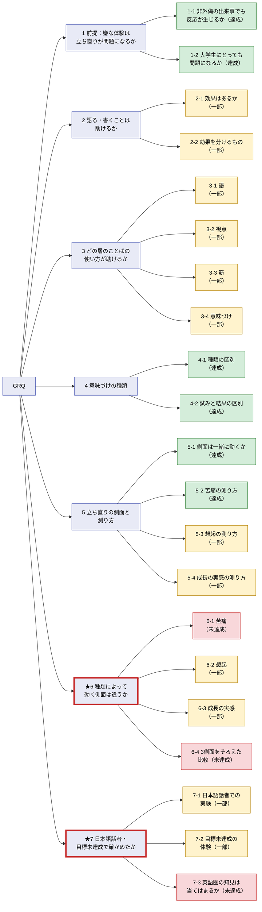

# 研究進捗の構造化

最終更新：2026-11-16

> **要点**：先行研究で達成されているのは、(a) 語る・書くことには効果があるが、小さく条件で変わること、(b) 書き方で効果が変わり、意味づけが鍵とされること、(c) 意味づけには種類があり、立ち直りの側面（苦痛・想起・成長の実感）は別々に動くこと。達成されていないのは、(d) 意味づけの種類によって、立ち直りのどの側面に効果が現れるかを、種類同士を比べた実験で確かめること、(e) それを日本語話者の大学生の目標未達成の体験で確かめること（現状は小規模・探索的な研究のみ）。(d)(e) がSRQの扱う空白である。

## 1. 全体像

### 読み方

- GRQを7つの問いに分け、プレ卒論1.2節と同じ順に並べた。広い問い（語る・書くことは効くか）から狭い問い（どの意味づけが、どの側面に効くか）へ絞っていく。
- 状態は末端の問いにだけつける。[達成]＝先行研究がおおむね答えている／[一部]＝答えはあるが、対象・方法・条件に限りがある／[未達成]＝答えが見当たらない（本調査の範囲で）。★＝SRQが扱う問い。
- 根拠の種類を〈〉で示す。〈メタ分析〉〈実験〉〈相関〉〈調査〉〈総説〉など。日本の参加者による研究には〈日本〉をつけた。

### テキスト版

```text
GRQ：青年期（大学生）の日本語話者が嫌な体験を物語として語るとき、どのようなことばの使い方が立ち直りを助けるのか
│
├─ 1 嫌な体験は、立ち直りが問題になる出来事か（前提）
│   ├─ [達成] 1-1 命に関わらない出来事でも、外傷後ストレス反応は生じるか
│   │   └─ 明らか
│   │       ├─ 離婚や失業の後にも、事故や虐待の後と同程度以上の反応が報告された〈調査〉（Mol ら, 2005）
│   │       └─ 日本でも「広義のトラウマ」として研究されてきた（伊藤ら, 2009）
│   └─ [達成] 1-2 大学生にとっても問題になるか
│       └─ 明らか
│           └─ 大学生でも、外傷後ストレス反応とレジリエンスとの関連が報告されている〈日本・調査〉（早川ら, 2023）
│
├─ 2 語る・書くことは、立ち直りを助けるか
│   ├─ [一部] 2-1 効果はあるか
│   │   ├─ 明らか
│   │   │   ├─ 有意な効果はあるが小さく（r = .075）、大きさは条件で変わる〈メタ分析・146研究〉（Frattaroli, 2006）
│   │   │   └─ 臨床では、物語に基づく介入がPTSD症状を減らす〈メタ分析〉（Raeder ら, 2023）
│   │   └─ 未明
│   │       ├─ 非臨床の大学生が自分で語る場面にも当てはまるか（臨床の介入は、PTSDの症状をもつ人を対象に治療者が主導する）
│   │       └─ 日本の筆記開示の実験は小規模で、手続きを改訂した再検証が必要とされている〈日本・25名〉（伊藤ら, 2009）
│   └─ [一部] 2-2 効果を分けるのは何か
│       ├─ 明らか
│       │   ├─ 同じ種類の体験でも、書き方で結果が変わる
│       │   ├─ 感情と考えの両方を書くと、肯定的な側面への気づきが高まった〈実験・122名〉（Ullrich & Lutgendorf, 2002）
│       │   └─ 感情だけを書くと、症状の報告が増えた（同）
│       └─ 未明
│           └─ 書き方のどの要素が効いているか（→ 3）
│
├─ 3 どの層のことばの使い方が助けるか
│   ├─ [一部] 3-1 語：どの語を選ぶか
│   │   ├─ 明らか
│   │   │   ├─ 洞察・因果の語が増えた人ほど、身体的健康が改善した〈相関・177名〉（Pennebaker ら, 1997）
│   │   │   ├─ 機能語の使い方が大きく変わった人ほど改善した〈相関〉（Campbell & Pennebaker, 2003）
│   │   │   ├─ 日本語の筆記でも、洞察の語の増加と身体的健康の改善との関連が示唆されている〈日本・探索的〉（坂本・佐藤, 2018）
│   │   │   └─ 感情を名指すと、意図しなくても感情が弱まる〈レビュー〉（Torre & Lieberman, 2018）
│   │   └─ 未明
│   │       ├─ 語を意図的に変えると効くか（いずれも相関）
│   │       └─ どの感情語を、どの程度、どの時点で使えば有効か
│   ├─ [一部] 3-2 視点：自分をどこから語るか
│   │   ├─ 明らか
│   │   │   ├─ 距離をとって理由を考えると、怒りが再燃しにくい〈実験〉（Kross ら, 2005）
│   │   │   └─ 三人称のセルフトークで、ストレス場面の苦痛が小さくなる〈実験〉（Kross ら, 2014）
│   │   └─ 未明
│   │       ├─ 筆記では一人称が有利という逆の結果がある〈実験〉（Seih ら, 2011）
│   │       ├─ 日本では非一人称の効果が一貫しない〈日本〉（清水ら, 2021；稲井・高橋, 2023）
│   │       ├─ 日本語で距離化に当たる言語形式は特定されていない
│   │       ├─ 日本語には主語の省略や自称詞の使い分けがあり、英語の代名詞の指標が使えない（鈴木, 1973；金水, 1989）
│   │       └─ 恥などの自己意識的感情では、距離の効果が小さい〈メタ分析〉（Moran & Eyal, 2022）
│   ├─ [一部] 3-3 筋：どう展開させ、締めくくるか
│   │   ├─ 明らか
│   │   │   └─ 否定的な場面が肯定的な結果に転じる展開（救済）が、幸福感と関連する〈相関〉（McAdams ら, 2001）
│   │   └─ 未明
│   │       ├─ 因果の向き
│   │       └─ 日本では救済と幸福感の関連が弱く、受容や未解決で終わる語りが見られる〈4か国438名〉（Turner ら, 2024）
│   └─ [一部] 3-4 意味づけ：体験に理由・教訓・意味を見いだすか
│       ├─ 明らか
│       │   ├─ 書く効果を説明する過程とされてきた（Ullrich & Lutgendorf, 2002；Pennebaker ら, 1997；Raeder ら, 2023）
│       │   ├─ 教示で促せる（Ullrich & Lutgendorf, 2002；遠藤・湯川, 2018）
│       │   └─ 3-2の距離の効果や3-3の救済にも、意味づけが関わっている可能性がある（解釈）
│       └─ 未明
│           └─ どの種類の意味づけが、どの側面に効くか（→ 4、6）
│
├─ 4 意味づけには、どんな種類があるか
│   ├─ [達成] 4-1 種類の区別
│   │   └─ 明らか
│   │       ├─ 理解（なぜ起きたかの説明）と利点発見（得たものの発見）が代表的な区別（Davis ら, 1998）
│   │       └─ 得られる意味には、受容、原因の理解、自己の捉え方の変化なども含まれる（Park, 2010）
│   └─ [達成] 4-2 試みと結果の区別
│       └─ 明らか
│           └─ 意味づけの「試み」と「得られた意味」は別物で、意味が得られないまま試みが続くと、反すうに変わりうる〈総説〉（Park, 2010）
│
├─ 5 立ち直りの何が、どう変わるか（側面と測り方）
│   ├─ [達成] 5-1 側面は一緒に動くか
│   │   └─ 明らか
│   │       ├─ 一緒に動くとは限らない
│   │       ├─ 成長の実感が高まっても、苦痛には群の差が出なかった〈実験〉（Slavin-Spenny ら, 2011；Stockton ら, 2014）
│   │       ├─ 書き方によって効く側面が違った〈実験・198名〉（Guastella & Dadds, 2008）
│   │       └─ 日本の大学生では、成長の実感が外傷後ストレス反応と正に相関した〈日本・312名〉（Taku ら, 2007）
│   ├─ [達成] 5-2 苦痛（侵入・回避）の測り方
│   │   └─ 明らか
│   │       ├─ IES-R-Jで測れる（Asukai ら, 2002）
│   │       ├─ 受験の失敗にも使われている〈日本〉（木村・板倉, 2025）
│   │       └─ 注意点として、筆記の直後は苦痛が一時的に上がり（Smyth, 1998）、記憶を評定するだけでも苦痛が下がる（Rubin ら, 2010）
│   ├─ [一部] 5-3 想起（否定的な感情語）の測り方
│   │   ├─ 明らか
│   │   │   └─ 語り直しの後の想起で、感情語の使い方が変わる〈日本〉（池田・仁平, 2009）
│   │   └─ 未明
│   │       ├─ 苦痛の変化と同時に測った研究が見当たらない
│   │       └─ 日本語の感情語を数える標準的な辞書（J-LIWC2015）は2022年に出たばかり（五十嵐ら, 2022）
│   └─ [一部] 5-4 成長の実感の測り方
│       ├─ 明らか
│       │   └─ PTGI-Jで測れる〈日本〉（Taku ら, 2007）
│       └─ 未明
│           ├─ 自己報告の成長の多くは、実際の変化を反映しないと指摘されている（Boals, 2023）
│           └─ 回復とは別の概念で、立ち直りの側面に含める扱いには検討が要る
│
├─ 6 意味づけの種類によって、効く側面は違うか ★SRQ1〜3
│   ├─ [未達成] 6-1 苦痛
│   │   ├─ 明らか
│   │   │   ├─ 理解が得られた人ほど苦痛が低い〈相関〉（Davis ら, 1998；Holland ら, 2006）
│   │   │   └─ 侵入・回避の低下を早めたのは曝露型で、意味づけの書き方ではない〈実験〉（Guastella & Dadds, 2008）
│   │   └─ 未明
│   │       └─ 書き方として促した実験では、理解型と利点発見型の差が示されていない〈68名・脱落40%〉（Lichtenthal & Cruess, 2010）
│   ├─ [一部] 6-2 想起
│   │   ├─ 明らか
│   │   │   └─ 肯定的に語り直したり、肯定的な意味を見いだしたりすると、後の想起が肯定的になる〈実験〉（池田・仁平, 2009；Speer ら, 2021）
│   │   └─ 未明
│   │       └─ 肯定的な側面を求めない意味づけ（理解など）でも、否定的な感情語が減るか
│   ├─ [一部] 6-3 成長の実感
│   │   ├─ 明らか
│   │   │   ├─ 利点発見型で成長の報告が増える〈実験〉（Guastella & Dadds, 2008）
│   │   │   ├─ ただし、書き方を指定しない開示でも高まる（Slavin-Spenny ら, 2011；Stockton ら, 2014）
│   │   │   └─ 調節が成長を予測する〈日本・相関〉（川須・福岡, 2025）
│   │   └─ 未明
│   │       ├─ 意味づけの種類によって差が出るか
│   │       └─ 利点発見型は、書く内容と尺度の項目が重なる
│   └─ [未達成] 6-4 3側面をそろえて測り、種類だけを変えた実験
│       └─ 未明
│           ├─ 見当たらない
│           ├─ 種類を比べた実験は、症状だけを測った（Lichtenthal & Cruess, 2010）
│           └─ 侵入・回避と成長を両方測った実験は、理解型を含まない（Guastella & Dadds, 2008）
│
└─ 7 日本語話者の大学生・目標未達成の体験で確かめられているか ★
    ├─ [一部] 7-1 日本語話者で、書き方や語り方を変えた実験
    │   ├─ 明らか
    │   │   ├─ トラウマの構造化開示（伊藤ら, 2009 ほか）
    │   │   ├─ 対人ストレス経験から得た利益を書くと敵意が下がる（羽鳥ら, 2013）
    │   │   └─ 捉え直しを促すと怒りの持続が弱まる〈55名〉（遠藤・湯川, 2018）
    │   └─ 未明
    │       └─ 意味づけの種類同士を比べた実験はない
    ├─ [一部] 7-2 目標未達成の体験
    │   ├─ 明らか
    │   │   ├─ 受験準備の肯定的な語り直しで、想起の感情語が変わる（池田・仁平, 2009）
    │   │   ├─ 失敗の原因を説明すると、1週間後の否定的な反応が弱い〈69名・探索的〉（外山・藏本, 2019）
    │   │   └─ 受験失敗の語り直しで回避が下がる〈19名・統制群なし〉（木村・板倉, 2025）
    │   └─ 未明
    │       └─ 統制された条件のもとで、種類同士を比べた研究はない
    └─ [未達成] 7-3 英語圏の知見は当てはまるか
        └─ 未明
            ├─ 意味づけの種類の効果が日本語話者でも同じかは、確かめられていない
            └─ 日本で救済と幸福感の関連が弱いこと（3-3）は、肯定的な帰結を見いだす意味づけの効果が、文化によって異なる可能性を示す
```

### 図版

凡例：緑＝達成／黄＝一部／赤＝未達成／赤の太枠＝★SRQが扱う問い



## 2. 意味づけの種類 × 立ち直りの側面

ツリーの6と7を、一つの表にまとめた。SRQ1〜3は、この表の3つの列にそれぞれ対応する。

| 意味づけの種類 | 苦痛（侵入・回避） | 想起（否定的な感情語） | 成長の実感 |
| --- | --- | --- | --- |
| 理解（なぜ起きたか） | ○ 理解が得られた人ほど苦痛が低い／△ 実験では利点発見型との差なし | — | — |
| 利点発見（何を得たか） | △ 実験では理解型との差なし。曝露型のほうが早く下がる | — | ◎ 成長の報告が増える |
| 肯定的な方向づけ（語り直し・肯定的な意味の発見） | — | ◎日 想起が肯定的になる | — |
| 原因の説明（失敗の原因を考える） | — | △日 1週間後の否定的な反応が弱い（評定・探索的） | — |
| 過去／未来に焦点を当てた肯定的な語り直し | △日 回避が下がる（統制群なし） | — | △日 一部で傾向 |
| 調節（考え方そのものを変える） | — | — | ○日 成長を予測する |
| （参考）曝露 | ◎ 低下を早める | — | — |
| （参考）書き方を指定しない開示 | 差なし | — | ◎ 高まる |

印：◎＝実験で効果あり／○＝相関のみ／△＝結果が割れる、小規模、統制群なし、評定のみのいずれか／—＝見当たらない（本調査の範囲で）／日＝日本の参加者

根拠：理解（Davis ら, 1998；Holland ら, 2006；Lichtenthal & Cruess, 2010）、利点発見（Lichtenthal & Cruess, 2010；Guastella & Dadds, 2008）、肯定的な方向づけ（池田・仁平, 2009；Speer ら, 2021）、原因の説明（外山・藏本, 2019）、過去／未来（木村・板倉, 2025）、調節（川須・福岡, 2025）、曝露（Guastella & Dadds, 2008）、指定のない開示（Slavin-Spenny ら, 2011；Stockton ら, 2014）

この表から言えるのは次の2点である。苦痛の列に◎のつく意味づけはない。3つの列をそろえて、種類同士を比べた研究もない。

## 3. まだ達成されていない理由

プレ卒論1.2.8節の整理。いずれも本調査の範囲で得た手がかりに基づく推測を含む。

| 理由 | 中身 | 根拠 |
| --- | --- | --- |
| 研究の対象の偏り | 理解と利点発見の区別は、死別を対象に検討されてきた。学業などの日常的な失敗は、意味づけの種類の研究では扱われにくかった。達成場面の失敗を扱った研究は、原因の考え方と感情反応の関係を見ており、種類の比較はしていない | Davis ら, 1998；Holland ら, 2006；Lichtenthal & Cruess, 2010；外山・藏本, 2019 |
| 方法の制約 | 種類と適応の関係は、主に相関研究で調べられてきた。教示で特定の過程を促すと、狙っていない過程も変わる。種類を比べた実験は1群20名未満で、脱落も多い。記憶を評定するだけで苦痛が下がるため、差が出にくい | Nazarian & Smyth, 2013；Lichtenthal & Cruess, 2010；Rubin ら, 2010 |
| 測る側面の違い | 筆記開示の研究は心身の健康を、語り直しの研究は想起の感情語を、心的外傷後成長の研究は成長の実感を測ってきた。共通の指標がないため、3つの側面を同時に測る研究が生まれにくかった | Frattaroli, 2006；池田・仁平, 2009；Taku ら, 2007 |
| 道具の未整備 | 日本語の文章の語を心理的なカテゴリで数える標準的な辞書（J-LIWC2015）は、2022年に発表されたばかり | 五十嵐ら, 2022 |

## 4. 調査の範囲と、調査として残っていること

**調べたもの**

- 体系知識の書籍：3冊（『可能世界の心理』『ナラティヴ研究』『ビジュアル・ナラティヴ』）
- 精読：10本（明らかになっている点と、なっていない点は、プレ卒論の付録の表にある）
- プレ卒論の参考文献：53編。関連文献リスト：32編（体験の領域の検討に使った13編を含む）
- モデル論文：2編（池田・仁平, 2009；Pennebaker ら, 1997）
- 比べる意味づけの候補ごとの根拠：SRQ発表準備ノート（11/8）で整理し始めた（帰属の再訓練、自分とのつなげ方など）。プレ卒論にはまだ入れていない

**調査として残っていること**（[研究の現状と今後.md](研究の現状と今後.md) の1-2、2-5、3-4に対応）

- [ ] 木村・板倉 (2025) の本文を読む（抄録のみ確認）。過去／未来の条件差、教示文、IES-R-Jの測定時期を確かめる
- [ ] Guastella & Dadds (2008) の本文を読む（要旨のみ確認）。利点発見型での侵入・回避の推移を確かめる
- [ ] Lichtenthal & Cruess (2010) の教示文を精読する
- [ ] 伊藤ら (2009) で「広義のトラウマ」に当たる記述を確かめる
- [ ] 社会的な背景のうち、出典のない2つの主張（大学生はさまざまな嫌な体験をする／言語化する機会は日常に多い）の出典を探す

## 5. 根拠資料

- プレ卒論 第1章（2026-11-12提出版）
- SRQ発表準備ノート（2026-11-08）
- Slack #b3_seminar：[10/20 菊池先生の指示（先行研究で何が達成され、何が達成されていないかを整理し、SRQを絞る）](https://k-lab-waseda.slack.com/archives/CA4HTQ7EU/p1792446877054119)
- [GM/研究の現状と今後.md](研究の現状と今後.md)
